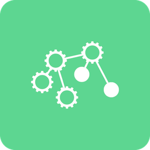

<p align="center">
  
</p>

<h1 align="center">Social Production</h1>

<p align="center">
  A social network for organizing real work together: projects, events, services and mutual aid, decided by the people doing them.
</p>

<p align="center">
  <a href="https://web-production-885ec.up.railway.app">Try the prototype</a> ·
  <a href="https://discord.gg/VvbJ3hhEPb">Discord</a> ·
  <a href="https://www.reddit.com/r/SocialProduction/">Reddit</a>
</p>

---

Social Production helps people find each other and coordinate collective activity outside the logic of markets, wages and private profit. It is in Phase 1: a working web prototype focused on facilitation, used to test the social mechanics before legal, funding and peer-to-peer infrastructure arrive.

## What you can do today

- **Projects.** Start production, organisation and software projects, plus collective and personal services. Each moves through phases (proposal, plan, activity, close), and members vote to advance.
- **Events.** Public events, or private ones for invitees or a private community. Run them collaboratively, or let organizers decide directly.
- **Plans and activities.** Propose plans, rate them against shared criteria and the values members added, then schedule activities with roles people can take.
- **Channels and communities.** Join topic channels and public or private communities, each with its own picture, settings and member votes.
- **Help requests and posts.** Ask for help or share news with the people who follow you.
- **Chat and calls.** Direct and group chats, a chat for every project and event, replies, pinned messages, and voice calls.
- **Map and calendar.** Find activity near you, and see times in your own time zone.
- **Fair voting.** New accounts warm up before they can vote, full members vouch for others, and suspected bots go to a public review, so votes stay with real people.

It runs as an installable web app (PWA) on phones and desktops.

## Repositories

| Repo | What it is |
|---|---|
| [`web`](https://github.com/social-production/web) | SvelteKit frontend and PWA |
| [`web-backend`](https://github.com/social-production/web-backend) | FastAPI API with Postgres and Redis |
| [`assets`](https://github.com/social-production/assets) | Logos, app icons and shared images |

## Run it locally

You need [Docker](https://docs.docker.com/get-docker/) and [Node.js 18+](https://nodejs.org/).

```bash
# Backend (API on http://localhost:8000, docs at /docs)
git clone https://github.com/social-production/web-backend
cd web-backend
docker compose up -d --build

# Frontend (app on http://localhost:5173)
git clone https://github.com/social-production/web
cd web
cp .env.example .env.local   # VITE_BACKEND=fastapi, VITE_API_URL=http://localhost:8000
npm install
npm run dev
```

The [`web`](https://github.com/social-production/web/blob/main/README.md) and [`web-backend`](https://github.com/social-production/web-backend/blob/main/README.md) READMEs cover setup in more detail.

## Roadmap

1. **Web prototype** *(now)*. Conventional backend and PWA, facilitation only with no asset holding, tested for usability, security and governance, and opening to public use as it stabilises.
2. **Legal entity and funding.** A non-profit foundation, community funding and stewardship inside Social Production, and coordination of physical assets.
3. **Peer-to-peer backend.** Research toward Holochain, p2panda or similar, then a gradual move off the conventional backend.
4. **Full model.** Shutdown-resistant infrastructure and non-market coordination at scale.

## Get involved

Come say hello on [Discord](https://discord.gg/VvbJ3hhEPb) or [Reddit](https://www.reddit.com/r/SocialProduction/), try the [prototype](https://web-production-885ec.up.railway.app), or open an issue in either repo.
